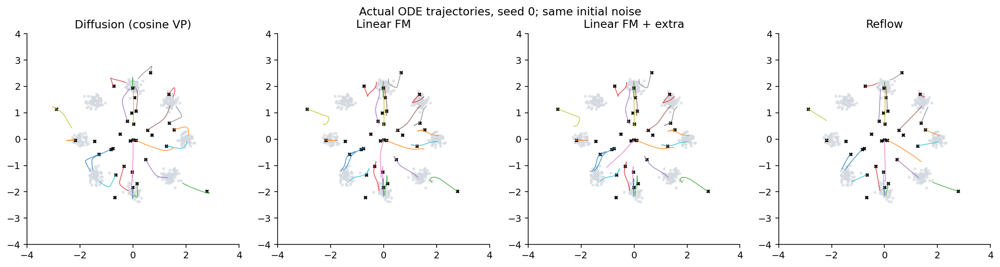
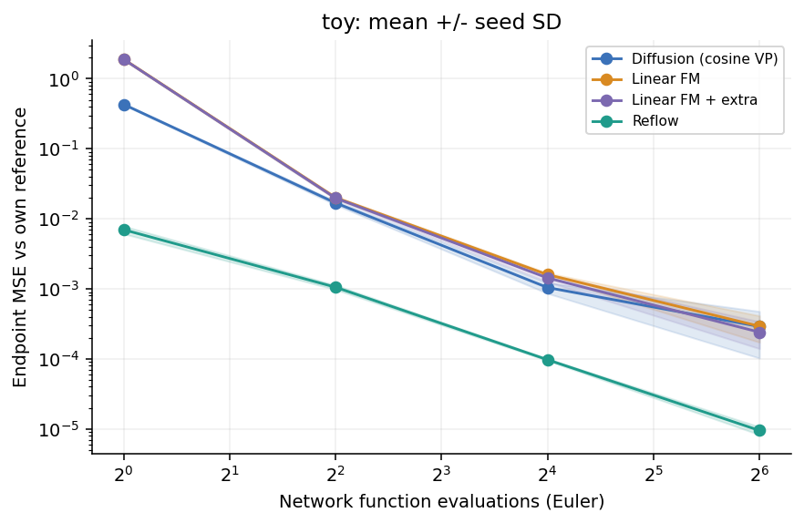
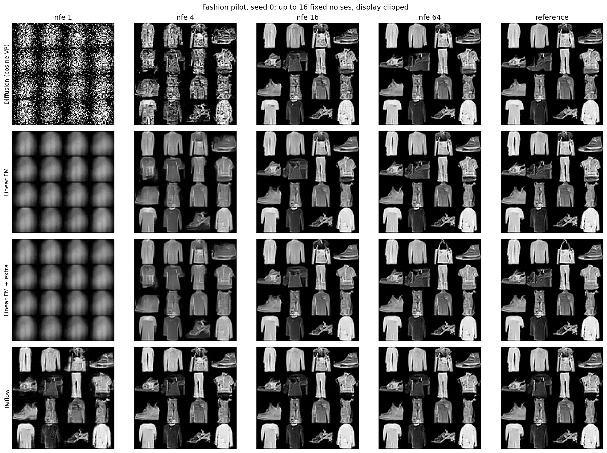

# Flow Path Lab

**扩散式路径、线性 Flow Matching 与 Reflow 对少步 ODE 生成的影响**

单卡 RTX 4090 上的学习与组会实验，使用二维八高斯和 Fashion-MNIST，
比较四组方法、三个随机种子。本仓库包含实际运行代码、配置、逐种子结果与图表。
这是受控的小规模实验，不是原论文完整性能复现。



图中使用相同初始噪声，通过多步 Heun 积分记录实际生成轨迹；不是一步生成图。

## 四组对照

统一使用噪声 t=0、数据 t=1，网络直接预测 dx/dt，以速度 MSE 训练。

| 组别 | 条件训练路径与配对 | 实验作用 |
|---|---|---|
| Diffusion (cosine VP) | x(t)=cos(πt/2)z+sin(πt/2)y；独立噪声与真实数据 | 扩散式概率路径基线 |
| Linear FM / 1-RF | x(t)=(1-t)z+ty；独立配对 | 线性路径基线 |
| Linear FM + extra | 从 Linear FM 的模型、EMA、优化器和 RNG 状态继续原目标训练 | 控制额外训练更新数 |
| Reflow / 2-RF | 同一基础模型生成 10,000 对 (z,T(z))，再做线性插值训练 | 检验教师重配对后的效果 |

扩散组属于 FM 式速度回归下的扩散路径实验，并非原始 DDPM 或 DDIM 复现。
这里 Linear FM 的目标与初始 RF 一致。条件插值为直线，不意味着学到的 ODE 轨迹为直线。
第 3、4 组额外更新数相同，但 Reflow 另有教师生成成本。

## 实验配置

完整配置：[configs/round2.json](configs/round2.json)。

| 参数 | 二维八高斯 | Fashion-MNIST |
|---|---|---|
| 数据 | 半径 2 的圆周上 8 个等权高斯；各轴标准差 0.15，在线采样 | 60,000 张 28×28 灰度训练图；无条件生成，归一化至 [-1,1] |
| 网络 | MLP，宽度 128 | SmallUNet，基础通道 32 |
| batch size | 1024 | 128 |
| 基础训练 / 额外训练 | 10,000 / 5,000 更新 | 20,000 / 10,000 更新 |
| Adam 学习率 / warmup | 0.001 / 100 更新 | 0.0002 / 200 更新 |
| 训练精度 | FP32 | BF16 |
| 评估样本数 / 种子 | 4096 / 0,1,2 | 512 / 0,1,2 |

均匀时间采样，梯度裁剪范数 1；EMA 上限 0.9999，实际 decay=min(0.9999,(1+step)/(10+step))。
低步数采样使用 Euler，NFE=1、4、16、64。教师和评估使用 FP32、关闭 TF32。
参考求解器为 Heun，经过连续两次步数加倍和 RK4 交叉检查。
其有限探针整体 RMSE 判据不提供全体样本逐个误差保证。

## 已完成的组会结果

服务器实际完成 58/58 阶段，共 24 个模型、270,000 次训练更新，墙钟时间约 **56 分 12 秒**。
硬件为 RTX 4090；环境为 Python 3.10.12 / PyTorch 2.6.0+cu126。
其他机器、软件版本或共享 GPU 下耗时可能不同。

下表为三个种子的均值 ± 样本标准差；未进行显著性检验。

| NFE=4，相对各自参考解的端点 MSE ↓ | Linear FM + extra | Reflow | 均值下降 |
|---|---:|---:|---:|
| 二维八高斯 | 0.0198071 ± 0.00078 | 0.00105578 ± 0.000077 | 94.67% |
| Fashion-MNIST | 0.122061 ± 0.0035 | 0.00751204 ± 0.00057 | 93.85% |




**结论边界：** Reflow 在本配置下更容易用少步积分逼近自身参考解，这不等于生成质量全面提升。
二维参考解的有效样本比例从等量续训组的 96.99% 降至 92.46%，但仍覆盖 8 个模式；
SW2 没有显示明确一致的整体劣化。Fashion 实验没有 FID 等独立图像质量指标。
Straightness 指标同时反映路径几何和运动速度，并非纯几何曲率。
Reflow 同时改变配对依赖结构、端点分布和有限样本池，不能将差异唯一归因于相关性。

- [详细分析与组会讲稿](docs/RESULTS_CN.md)
- [逐种子指标 CSV](results/round2/report/metrics.csv)
- [均值与标准差 CSV](results/round2/report/summary.csv)
- [数值参考检查](results/round2/report/quality_checks.json)
- [原始离线 HTML 报告](results/round2/report/report.html)：下载仓库后用浏览器打开。
- [实测环境](results/round2/environment.json)

## Linux 运行与监测

```bash
git clone https://github.com/Tu12138Ran/RF-FM--ODE-.git flow-path-lab
cd flow-path-lab
bash setup.sh
CUDA_VISIBLE_DEVICES=0 bash start.sh
bash monitor.sh
```

首次运行自动下载 Fashion-MNIST 并校验 MD5，数据文件不放入 Git。
setup 优先复用可用 CUDA 环境；也可指定已有环境：

```bash
PYTHON_BIN=/absolute/path/to/python bash setup.sh
```

若 Ubuntu 提示 ensurepip 缺失，安装与你的 Python 版本对应的 venv 包（例如 Python 3.10 使用
`sudo apt install python3.10-venv`），再运行 setup。
新建环境的默认 torch 安装为 2.7.1/cu118；它与实测环境不同。
如需匹配实测主要依赖，可先在独立 Python 3.10 环境安装：

```bash
python3.10 -m venv .venv
.venv/bin/python -m pip install torch==2.6.0 --index-url https://download.pytorch.org/whl/cu126
.venv/bin/python -m pip install numpy==1.26.4 'matplotlib>=3.8,<4'
PYTHON_BIN="$PWD/.venv/bin/python" bash setup.sh
```

主要依赖版本一致仍不保证跨设备或环境逐位复现。

在另一个 SSH 窗口查看进度：

```bash
cd ~/flow-path-lab
bash monitor.sh
# 或查看日志
tail -f runs/round2/console.log
```

Ctrl+C 仅关闭监测。58 个阶段的计数不是墙钟时间百分比。
中断后保持配置和代码不变，重复 start 命令即可续跑；改配置请指定新的 OUT 目录。
完成后报告位于 runs/round2/report/report.html，运行 `bash export_results.sh` 导出结果。

## 验证与文件说明

```bash
python -m unittest discover -s tests -v
```

`setup.sh` 也会运行测试。历史本地验证见 [VALIDATION.md](VALIDATION.md)，
该文件记录的是服务器正式训练之前的验证状态；正式服务器结果保存在 results/round2。
`configs/smoke.json` 仅用于流程测试，不可用于科研结论。

训练与评估核心 Python 文件保持原实验版本，SHA-256 见
[source_hashes.json](results/round2/source_hashes.json)。
仓库未包含权重、配对张量、原始数据集和服务器控制台日志；从头运行可重新生成它们。
本仓库仅覆盖本次四组路径实验，后续 RF→CM 蒸馏属于另一项实验。

## 参考论文

- Lipman et al. [Flow Matching for Generative Modeling](https://arxiv.org/abs/2210.02747), ICLR 2023.
- Liu et al. [Flow Straight and Fast: Learning to Generate and Transfer Data with Rectified Flow](https://arxiv.org/abs/2209.03003), ICLR 2023.
- Song et al. [Score-Based Generative Modeling through Stochastic Differential Equations](https://arxiv.org/abs/2011.13456), ICLR 2021.
- Xiao et al. [Fashion-MNIST](https://arxiv.org/abs/1708.07747), 2017.

Fashion-MNIST 的来源和许可证见 [third_party](third_party)。本项目未另行授予代码开源许可证。
