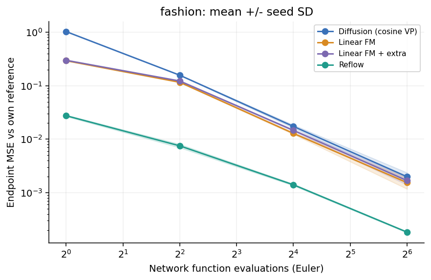
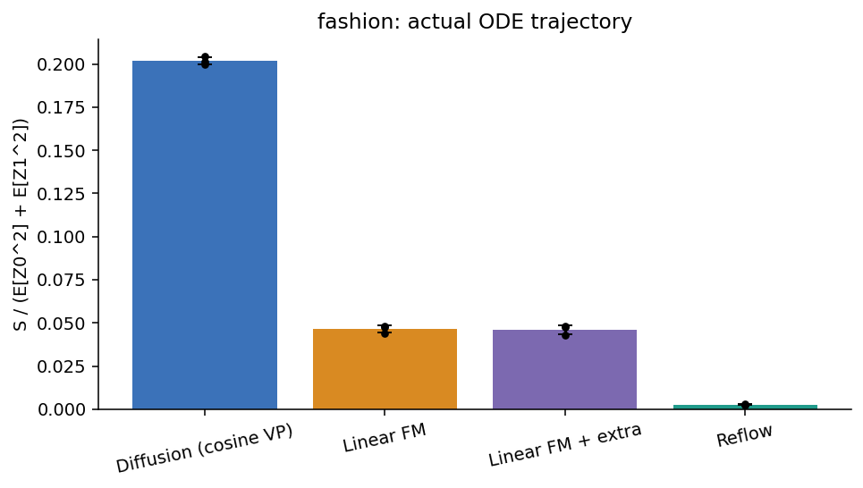
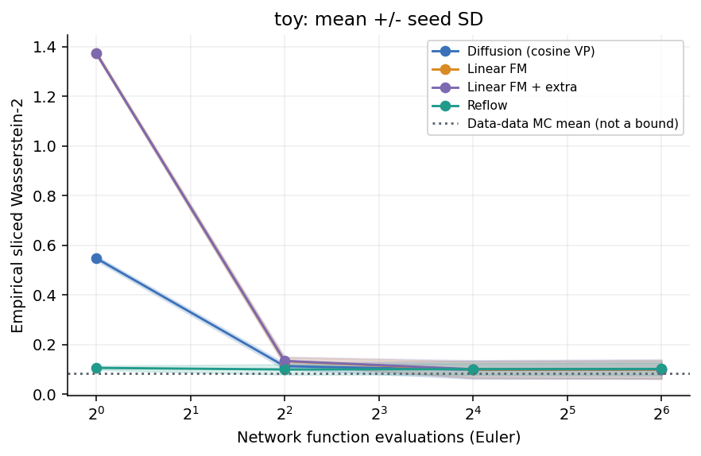
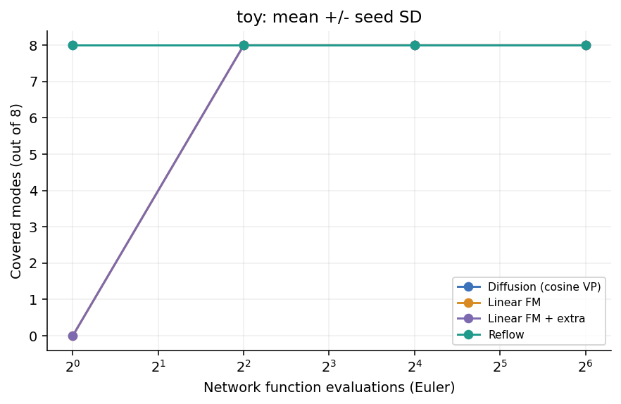
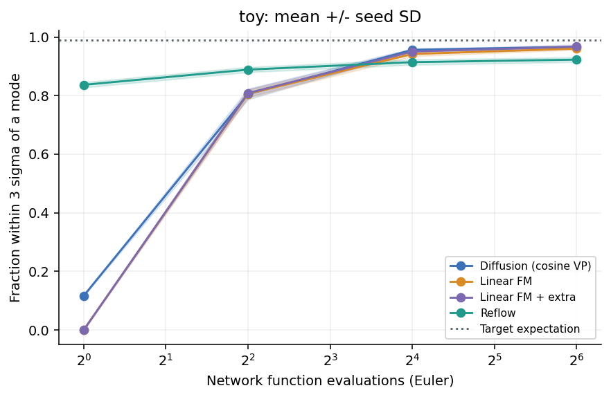
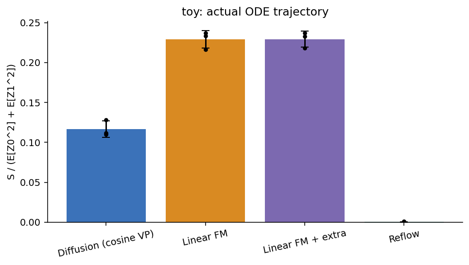
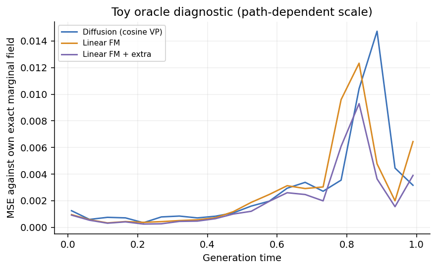

# 路径比较实验：自动生成的组会材料

**实验状态：实验已执行；结论须结合预算与收敛检查**

## 研究问题
扩散插值、线性插值与 reflow 配对如何影响实际 ODE 轨迹和低 NFE 求解？

## 方法与控制
- 时间从噪声 0 到数据 1；所有方法使用同一个网络结构、速度 MSE、均匀时间采样。
- 扩散组为余弦 VP 条件路径：X_t=sin(pi*t/2)*x+cos(pi*t/2)*epsilon。不是原始离散 DDPM 完整复现。
- 线性 FM 使用独立配对；reflow 使用线性 FM 的 EMA 教师生成的端点配对。
- linear_extra 与 reflow 从同一模型、EMA 和优化器状态分叉，额外更新数相同；教师生成成本单独记录。
- 所有评估及教师生成采用 FP32 并关闭 TF32；训练仍保留原来的 BF16/TF32 配置。
- Euler NFE=N，Heun NFE=2N，RK4 NFE=4N；每个模型使用自己的参考解。
- 参考精度要求连续两次 Heun 步长加倍检查通过，再与相近 NFE 的 RK4 解交叉核对。
- 检查条件为 RMSE <= atol + rtol * max(RMS(reference),0.1)；这是有限探针诊断，不是严格误差界。
- 不同种子的自适应参考 NFE 不再拆成不同组；summary.csv 单独记录实际 NFE 范围。
- 原始 S 按坐标平均；归一化 S 除以 E[Z0^2]+E[Z1^2]+1e-8。
- 二维 SW2 使用 128 个固定投影；模式覆盖要求距中心<=0.45，且该模式有效样本至少占总数 1%。
- EMA 使用 warm-start decay=min(0.9999,(1+global_step)/(10+global_step))，避免短训练被初始权重主导。

## 实际配置
```json
{
  "name": "round2_group_meeting",
  "description": "Fresh training: 3 seeds for both tasks; strict FP32 references with consecutive doubling and RK4 checks",
  "training_tf32": true,
  "tasks": {
    "toy": {
      "seeds": [
        0,
        1,
        2
      ],
      "width": 128,
      "batch": 1024,
      "steps": 10000,
      "extra_steps": 5000,
      "lr": 0.001,
      "warmup": 100,
      "ema_decay": 0.9999,
      "amp": false,
      "log_every": 100,
      "save_every": 500,
      "pair_count": 10000,
      "eval_batch": 256,
      "eval_samples": 4096,
      "trace_samples": 64,
      "probe_samples": 256,
      "reference_start": 32,
      "reference_min": 128,
      "reference_max": 1024,
      "reference_rtol": 0.005,
      "reference_atol": 0.0001,
      "reference_consecutive": 2,
      "baseline_repeats": 20,
      "nfes": [
        1,
        4,
        16,
        64
      ]
    },
    "fashion": {
      "seeds": [
        0,
        1,
        2
      ],
      "width": 32,
      "batch": 128,
      "steps": 20000,
      "extra_steps": 10000,
      "lr": 0.0002,
      "warmup": 200,
      "ema_decay": 0.9999,
      "amp": true,
      "log_every": 100,
      "save_every": 500,
      "pair_count": 10000,
      "eval_batch": 128,
      "eval_samples": 512,
      "trace_samples": 32,
      "probe_samples": 64,
      "reference_start": 32,
      "reference_min": 128,
      "reference_max": 1024,
      "reference_rtol": 0.005,
      "reference_atol": 0.0001,
      "reference_consecutive": 2,
      "nfes": [
        1,
        4,
        16,
        64
      ]
    }
  }
}
```

## 需要在汇报中明确的限制
- 本实验不计算 FID；Fashion 图像部分没有独立的定量分布质量指标，straightness/求解误差不能替代生成质量。

## 数值结果
完整求解诊断保存在 quality_checks.json；参考检查失败的求解误差曲线用虚线并标记 ref unverified。
二维 SW2 的 data-data MC 水平线来自相同评估真值与独立真实抽样；它是有限样本尺度参考，不是理论下界或显著性检验。
完整逐种子数据见 metrics.csv；均值和种子间样本标准差见 summary.csv。
标准差不代表置信区间。单种子的 std=0 只是没有重复实验，不能解释为没有不确定性。

### fashion：固定 NFE 对照

| 方法 | 种子数 | NFE | 求解 MSE，均值±SD | SW2，均值±SD |
|---|---:|---:|---:|---:|
| Diffusion (cosine VP) | 3 | 4 | 0.15666 ± 0.000805 | 未测 |
| Linear FM | 3 | 4 | 0.11566 ± 0.0015 | 未测 |
| Linear FM + extra | 3 | 4 | 0.12206 ± 0.00354 | 未测 |
| Reflow | 3 | 4 | 0.007512 ± 0.000568 | 未测 |

### toy：固定 NFE 对照

| 方法 | 种子数 | NFE | 求解 MSE，均值±SD | SW2，均值±SD |
|---|---:|---:|---:|---:|
| Diffusion (cosine VP) | 3 | 4 | 0.016883 ± 0.00103 | 0.11228 ± 0.0122 |
| Linear FM | 3 | 4 | 0.020098 ± 0.000841 | 0.13233 ± 0.0152 |
| Linear FM + extra | 3 | 4 | 0.019807 ± 0.000779 | 0.13361 ± 0.0169 |
| Reflow | 3 | 4 | 0.0010558 ± 7.7e-05 | 0.099243 ± 0.021 |

## 六页汇报建议
1. 提出问题：路径形状和端点配对怎样影响少步生成。
2. 展示配置与四组对照，明确额外训练/教师成本。
3. 展示二维实际轨迹与归一化 straightness。
4. 同时展示目标分布质量、模式覆盖和求解误差曲线。
5. 展示 Fashion 固定噪声样本与多种子曲线；图像网格只展示第一个种子。
6. 根据实际数据写观察、可能解释和未排除的因素；不要预设 reflow 获胜。

## 判读规则
- 求解误差降低且分布质量保持，才支持更适合少步求解的解释。
- 轨迹更直但模式覆盖下降，提示生成质量存在代价。
- 高精度样本仍不好，应先检查学习误差与预算，而非只增加采样步数。
- 不能用三组不同目标的训练 loss 原始数值直接比较学习能力。

## 图表



fashion：Endpoint MSE vs own reference 随 NFE 的变化；阴影为种子间样本标准差，单种子不画阴影。



实际 ODE 轨迹的速度变化；不是训练插值的直线程度。归一化规则见方法说明。


网格仅展示首个种子的前 16 个固定噪声；定量曲线按全部种子汇总。仅显示时裁剪，求解及指标不裁剪。


toy：Endpoint MSE vs own reference 随 NFE 的变化；阴影为种子间样本标准差，单种子不画阴影。



toy：Empirical sliced Wasserstein-2 随 NFE 的变化；阴影为种子间样本标准差，单种子不画阴影。



toy：Covered modes (out of 8) 随 NFE 的变化；阴影为种子间样本标准差，单种子不画阴影。



toy：Fraction within 3 sigma of a mode 随 NFE 的变化；阴影为种子间样本标准差，单种子不画阴影。



实际 ODE 轨迹的速度变化；不是训练插值的直线程度。归一化规则见方法说明。


固定首个种子、固定初始噪声的实际轨迹；灰点为目标分布。

![二维生成分布；显示窗口固定为 [-4,4]，窗口外离群点仍计入定量指标。](toy_distributions.png)

二维生成分布；显示窗口固定为 [-4,4]，窗口外离群点仍计入定量指标。



独立配对组相对自身解析边缘向量场的误差；不同路径速度尺度不同，不能仅凭原始 MSE 排名。reflow 无该解析参照，故不展示。

## 来源
- Flow Matching: https://arxiv.org/abs/2210.02747
- Rectified Flow: https://arxiv.org/abs/2209.03003
- RF 作者说明: https://www.cs.utexas.edu/~lqiang/rectflow/html/intro.html
- Fashion-MNIST: https://github.com/zalandoresearch/fashion-mnist
